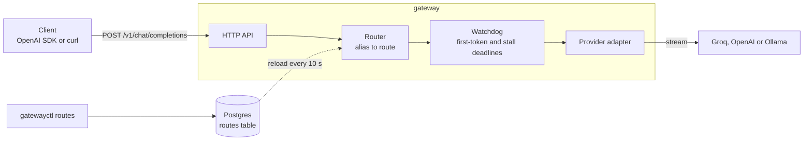

# llm-gateway

A multi-tenant, OpenAI-compatible LLM gateway in Go, with routing, rate limits, budgets, usage metering and tracing across Ollama, Groq, OpenAI and Anthropic.

Status: milestones 0 (walking skeleton) and 1 (streaming core) are built. The [roadmap](docs/design.md#8-roadmap-and-open-gaps) shows the milestones that add the other features.

## How it works



The gateway takes the OpenAI request shape, so an OpenAI SDK needs only a new base URL. The router maps the model name in the request to a route. Routes live in Postgres, and each replica keeps a copy in memory. The adapter streams the answer from the provider. A watchdog cuts a stream that does not start or that stops. The HTTP status waits up to 3 s for the first token, so an early upstream error gets a real status. The [API reference](docs/api.md) gives the details.

## Project layout

```text
.
├── cmd/
│   ├── fakeprovider/        the fake upstream as a server, for local and load tests
│   ├── gateway/             the HTTP server: composition root, graceful shutdown
│   └── gatewayctl/          admin commands: migrations and routes
├── internal/
│   ├── config/              settings parsed into typed values, with secret redaction
│   ├── fakeupstream/        a fake OpenAI chat completions server with fault modes
│   ├── httpapi/             endpoints, readiness checks, the OpenAI error shape
│   ├── money/               exact US dollar amounts in micro-dollars
│   ├── provider/            the provider contract, typed upstream errors, the upstream HTTP client
│   │   ├── ollama/          the adapter for Ollama's native chat API
│   │   ├── openaicompat/    the adapter for OpenAI-compatible APIs (Groq, OpenAI)
│   │   └── providertest/    the contract suite that every adapter runs
│   ├── router/              model alias to routes, from an in-memory snapshot
│   ├── sse/                 the Server-Sent Events writer and heartbeats
│   ├── store/
│   │   └── postgres/        the connection pool, readiness check, migrations, routes table
│   └── telemetry/           the structured logger, with trace IDs
│       └── otelsdk/         OpenTelemetry tracer and meter providers, exported over OTLP/HTTP
├── deploy/
│   ├── docker/
│   │   └── Dockerfile       distroless, non-root images for the gateway and the fake provider
│   ├── compose.yaml         the local stack: Postgres, migrations, gateway
│   └── compose.loadtest.yaml the overhead test stack
├── docs/
│   ├── design.md            the system design and roadmap
│   ├── adr/                 architecture decision records
│   ├── api.md               endpoints, errors, chat completions, routes
│   ├── configuration.md     every setting
│   ├── fake-provider.md     the fake provider and its fault modes
│   ├── benchmarks.md        the overhead test: method and full results
│   └── development.md       running locally, shutdown, CI
├── loadtests/
│   ├── k6/
│   │   └── overhead.js      one overhead case
│   └── run.sh               runs every overhead case and prints the tables
├── .github/                 CI workflow, Dependabot, pull request template
├── .golangci.yml            lint settings
└── readme_test.go           fails when the docs miss a setting, endpoint, package or fake directive
```

## Quick start

You need Docker with Compose and a Groq API key.

```bash
echo 'GROQ_API_KEY=<your key>' >> .env    # Compose reads it; git ignores it
make up                                   # build, start Postgres, migrate, start the gateway
curl localhost:8080/readyz                # {"status":"ready"}
docker compose -f deploy/compose.yaml run --rm migrate \
  routes add --alias chat --provider groq --upstream-model openai/gpt-oss-20b --priority 10
sleep 10                                  # the gateway reloads routes every 10 s
curl -N localhost:8080/v1/chat/completions \
  -d '{"model":"chat","stream":true,"messages":[{"role":"user","content":"hi"}]}'
```

## What works now

- Chat completions in the OpenAI shape, streamed or not, from Groq, OpenAI and Ollama.
- Model names map to routes, and a route change needs no deploy.
- An early upstream error, such as a rate limit, gets a real HTTP status.
- A slow model start gets heartbeats, so the client connection stays open.
- A stalled stream is cut, but a model that is still reasoning is not.
- An error after the stream starts is an error event, so a cut answer never looks complete.
- Health and readiness checks, and a shutdown that lets running requests finish.
- A fake provider with fault modes, for tests and load tests.

## Measured results

| Measure | Result | Conditions |
|---|---|---|
| Latency added per request | 0.22 to 0.29 ms p50 | Instant upstream, 1 user, 2026-10-12 |
| Latency added at 5 ms per token | 1 to 3 ms p50 | 1 and 10 users; within noise at 100 users; 2026-10-12 |
| Peak gateway memory under load | 69 MiB | Whole overhead run, 128 MiB limit, 2026-10-12 |
| Image size, compressed | 8.17 MB | `docker save` with gzip, 2026-10-12 |
| Cold start to ready | 179 to 185 ms | Container start to the first `/readyz` 200, 3 runs, 2026-10-12 |

Method, full tables and the connection-pool finding: [docs/benchmarks.md](docs/benchmarks.md).

## Design

- [docs/design.md](docs/design.md): requirements, estimates, architecture, data model, failure modes, security, operations and the roadmap.
- [docs/adr/](docs/adr/README.md): one architecture decision record per decision, with the options and the reasons.

## Development

```bash
make up              # build the image; start Postgres, run migrations, start the gateway
make logs            # follow the gateway's logs
make migrate-status  # list migrations and whether each is applied
make down            # stop the stack; the Postgres volume is kept
make test            # run every test; the Postgres tests need Docker
make build           # build both binaries into bin/
make loadtest        # run the overhead test (about 18 minutes)
make loadtest-down   # remove the overhead test stack and its volume
```

CI runs lint, the race-enabled tests, a vulnerability scan and an image build on every pull request and every push to main.

Reference: [configuration](docs/configuration.md), [API and routes](docs/api.md), [fake provider](docs/fake-provider.md), [benchmarks](docs/benchmarks.md), [development and CI](docs/development.md).
