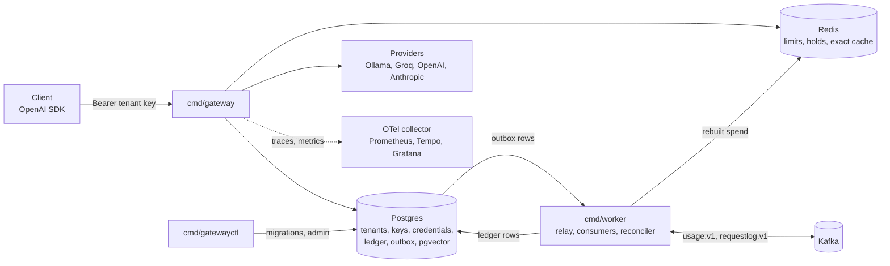
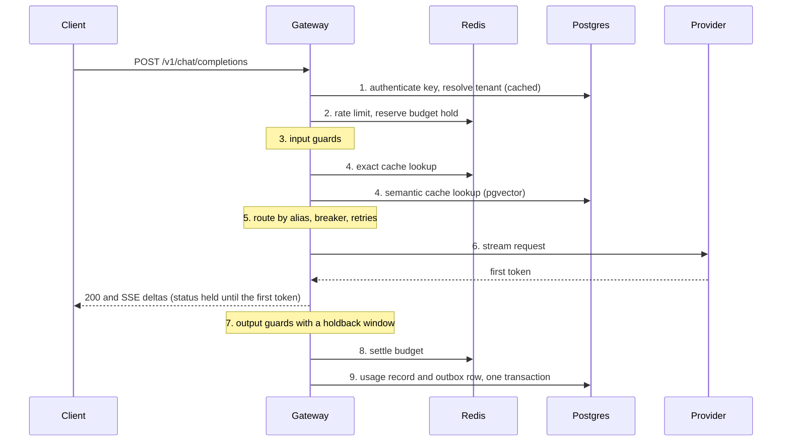

# llm-gateway design

llm-gateway is a multi-tenant, OpenAI-compatible LLM gateway. Each tenant calls one API with its own key. The gateway authenticates the key, applies the tenant's rate limits and budget, routes the request to a provider (Ollama, Groq, OpenAI or Anthropic), streams the answer back, and records usage and cost.

This document is the target design. Each part is marked:

- **Built (S0)**: in the code on the S0 branch.
- **Planned (Sn)**: designed here, built in slice Sn.

Decisions are recorded in [docs/adr/](adr/README.md).

## 1. Requirements

### Functional

| Requirement | Status |
|---|---|
| `GET /healthz` (liveness) and `GET /readyz` (readiness) | Built (S0) |
| `GET /v1/models` in the OpenAI list shape | Built (S0) as a stub. Planned (S1): lists the configured model aliases. |
| Every error in the OpenAI error envelope ([0002](adr/0002-openai-compatible-api-and-error-envelope.md)) | Built (S0) |
| `POST /v1/chat/completions`, streamed (SSE) and not streamed | Planned (S1) |
| Providers: Ollama, Groq, OpenAI ([0005](adr/0005-providers.md)) | Planned (S1) |
| Provider: Anthropic, and `response_format` across providers with output schema validation | Planned (S5) |
| Tenants, hashed API keys, encrypted per-tenant provider credentials | Planned (S3) |
| Routing: model aliases to an ordered provider list, failover before the first content delta, a breaker per endpoint, jittered retries that honour `Retry-After` | Planned (S4) |
| Rate limits, budget reservation and settlement, the exact cache | Planned (S7) |
| Usage metering: one usage event per request, a ledger with the price charged | Planned (S6) |
| Opt-in, redacted request logs, and eval sets built from them | Planned (S6, S9) |
| Input and output guards: PII redaction, prompt-injection flags (flag only, never block) | Planned (S10) |
| Semantic cache with a per-tenant filter | Planned (S11) |
| `gatewayctl`: `migrate up`, `down`, `status` | Built (S0) |
| `gatewayctl`: tenants, keys, credentials, eval | Planned (S3, S9) |

### Non-functional

| Requirement | How it is checked | Status |
|---|---|---|
| A dependency outage removes the pod from traffic and never restarts it | Measured: `/readyz` 503 within 320 ms of Postgres stopping, `/healthz` 200, no restart | Built (S0) |
| An in-flight request survives SIGTERM, inside the Kubernetes grace period | `TestInFlightRequestFinishesDuringShutdown`, `TestReadyzIs503DuringTheDrainDelay` | Built (S0) |
| No secret in logs or error bodies | Redaction tests through the real slog handlers and `encoding/json`; fixed 5xx message | Built (S0) for config and errors |
| No known vulnerability reachable from the code | `govulncheck` in CI | Built (S0) |
| The HTTP status is held until the first token; heartbeats keep the stream open; a stall timeout cuts a stream that stops | Contract tests against a fake provider | Planned (S1) |
| Gateway overhead over the upstream is measured | k6 p50 and p95 against a fake upstream. No target is set before the first measurement. | Planned (S1) |
| No usage is lost and none is counted twice when Kafka is down | Stop Kafka, send 100 requests, restart: 100 ledger rows, 0 duplicates after injected duplicates | Planned (S6) |
| Tenant A never reaches tenant B's credential, cache entry or request log | Isolation suite that attempts each access and fails if it succeeds | Planned (S3, S11) |
| Traces, RED metrics, time to first token and time per output token | Recorded-metrics and trace-propagation tests | Planned (S2) |
| The same manifests run on kind, EKS and GKE Autopilot | Kustomize base with an overlay per target ([0006](adr/0006-deploy-targets.md)) | Planned (S8, S12, S13) |

## 2. Back-of-envelope estimates

These are estimates from assumed planning figures, not requirements. They size the components and show where the limits are. S1, S2 and S8 replace them with measurements.

| Assumption | Value |
|---|---|
| A1. Requests per day, all tenants | 50,000 |
| A2. Peak rate over the daily average | 10x |
| A3. Mean duration of a streamed response | 10 s |
| A4. Serialized usage event | about 500 bytes |
| A5. Ledger row with its indexes, on disk | about 400 bytes |
| A6. Postgres time per request on the request path (auth lookup, outbox insert) | about 10 ms |
| A7. Opt-in request logs: share of requests, size after redaction, retention | 10%, 4 KB, 7 days |

| Estimate | Working | Result |
|---|---|---|
| Average rate | 50,000 / 86,400 s | about 0.6 requests/s |
| Peak rate | 0.6 x 10 | about 6 requests/s |
| Open streams at peak (Little's law: concurrency = rate x duration) | 6 x 10 s | about 60 |
| Busy Postgres connections at peak | 6 x 0.010 s | about 0.06 |
| `usage.v1` volume | 50,000 x 500 B | about 25 MB/day |
| Ledger growth | 50,000 x 365 x 400 B | about 18 million rows, 7.3 GB per year |
| `requestlog.v1` volume and retained size | 5,000 x 4 KB, kept 7 days | about 20 MB/day, 140 MB retained |
| Redis operations at peak (limit check, hold, settle) | 6 x 3 | about 18 ops/s |

What the estimates show:

- At this volume no component is near a throughput limit. The design is shaped by failure behaviour, tenant isolation and correct metering, not by throughput. The broker choice ([0004](adr/0004-kafka-for-the-usage-pipeline.md)) does not rest on volume.
- The pool size per replica (`DB_MAX_CONNS`, default 10) is far above the 0.06 busy connections. The real limit is scale-out: `replicas x DB_MAX_CONNS` must stay below Postgres' `max_connections` (100 by default). See section 8.
- An open stream holds a goroutine and its buffers, not a database connection, so open streams cost memory, not pool slots. S2 measures memory per stream.

## 3. Architecture

Two long-running processes and one admin binary:

- `cmd/gateway`: the request path. **Built (S0)**: health, readiness, the models stub, graceful shutdown, the Postgres pool. The rest is planned.
- `cmd/worker`: everything off the request path. **Planned (S6)**.
- `cmd/gatewayctl`: one-shot admin commands. **Built (S0)**: `migrate`.



### Request path

The nine steps run in `cmd/gateway`, in this order. **Planned (S1 to S11)**; the slice for each step is in brackets.

1. Authenticate the API key, which resolves the tenant (S3).
2. Admit: check the rate limit, then reserve budget in Redis (S7).
3. Run the input guards (S10).
4. Look up the exact cache (S7), then the semantic cache (S11).
5. Route: model alias, then an ordered provider list with a breaker and retries. Failover happens only before the first content delta (S4).
6. Stream from the provider. Hold the HTTP status until the first token, and send SSE heartbeats meanwhile. A stall timeout cuts a stream that stops sending tokens (S1).
7. Run the output guards, with a holdback window for streams (S10).
8. Settle the budget (S7).
9. Write the usage record and a transactional outbox row in one Postgres transaction (S6).



Holding the status until the first token lets the gateway fail over, or return a real error status, for any failure before content starts. After the first token the status is sent, so a later failure arrives as an error event in the stream.

### Off the request path

**Planned (S6, S7, S9).** The outbox decouples the request from Kafka: a request commits its outbox row with its own records, and the relay publishes later.

```text
Postgres outbox ─ relay (FOR UPDATE SKIP LOCKED) ─> Kafka usage.v1 (key tenant_id, no prompt content)
                                                     ├─ group billing   ─> Postgres ledger, idempotent on request_id,
                                                     │                     offsets committed after the transaction,
                                                     │                     dead-letter topic for records that keep failing
                                                     └─ group analytics ─> usage aggregates for dashboards
                ─ relay ─> Kafka requestlog.v1 (opt-in, redacted before produce, short retention) ─> eval sets (S9)

reconciler: Postgres ledger ─> Redis spend
```

## 4. Data model

**Built (S0):** migration 00001 enables the `vector` extension. **Planned:** the eight tables below.

| Table | Holds | Slice |
|---|---|---|
| `tenants` | One row per tenant | S3 |
| `api_keys` | Key prefix, key hash, `revoked_at`. The full key is never stored. | S3 |
| `provider_credentials` | Each tenant's provider keys, AES-GCM envelope encrypted (section 6) | S3 |
| `routes` | Model alias, provider, upstream model, priority, prices, default and maximum `max_tokens` | S4 |
| `budgets` | Spend limits per tenant and period | S7 |
| `usage_events` | One row per request, `request_id` primary key, with a snapshot of the price charged | S6 |
| `request_logs` | Opt-in, redacted prompts and responses | S6 |
| `outbox` | Events waiting for the relay | S6 |

### Tenant isolation: two layers

```text
request ─> API key ─> tenant_id
  layer 1, application: every query takes tenant_id from the authenticated key, never from the request body
  layer 2, Postgres row-level security: a policy on each tenant table hides rows of other tenants,
           so a query that forgets layer 1 still returns nothing it should not
```

Layer 2 works only for a role that does not bypass it. Superusers and roles with `BYPASSRLS` always bypass row-level security, and table owners bypass it unless the table uses `FORCE ROW LEVEL SECURITY`. In S0 the gateway connects as a superuser, so S3 adds a separate app role that does not own the tables ([0010](adr/0010-migrations-with-goose.md)).

## 5. Failure modes

What happens when each dependency fails, and what the client sees.

| Dependency | Failure | Gateway behaviour | Client sees | Status |
|---|---|---|---|---|
| Postgres | Down or unreachable | `/readyz` returns 503, so Kubernetes stops routing to the pod. `/healthz` stays 200, so no restart. The pool reconnects when Postgres returns. | New requests go to other pods. If all pods are out, the load balancer has no backend. | Built (S0), measured |
| Postgres | Down, for a request already on the pod | Auth and the outbox write need Postgres. How long a cached key stays valid is decided in S3. | An error in the OpenAI envelope. | Planned (S3, S6) |
| Postgres | Pool exhausted under load | The readiness ping waits for a connection and times out after 2 s, so the pod reports not ready although Postgres is up. | Fewer pods in rotation. See section 8. | Known trade-off, S8 |
| Redis | Down | Each check fails open or closed, as decided in S7. The planned behaviour: rate limits fail open, budgets fail closed. The reconciler rebuilds spend when Redis returns. | Requests within budget proceed. A request that needs a budget hold gets an error in the OpenAI envelope. | Planned (S7) |
| Kafka | Down | Nothing on the request path. Outbox rows accumulate in Postgres. The relay publishes them when Kafka returns, and billing is idempotent on `request_id`. | Nothing. | Planned (S6) |
| Provider | Error or 429 before the first token | Retry with jitter, honouring `Retry-After`, then fail over to the next provider in the route. The breaker opens for an endpoint that keeps failing. A 401 or 403 cools down that credential, not the provider. | A normal response from another provider, or an error status in the OpenAI envelope if every provider fails. | Planned (S4) |
| Provider | Drops mid-stream | No failover after content has started. Usage is marked truncated. | An error event in the SSE stream. | Planned (S4) |
| Provider | Stalls mid-stream | The stall timeout cuts the stream. | An error event in the SSE stream. | Planned (S1) |
| Client | Disconnects | The request context ends, which cancels the upstream call. | Nothing. | Planned (S1) |

## 6. Security

| Area | Design | Status |
|---|---|---|
| API keys | Random keys, stored as a prefix and a hash, with `revoked_at`. The hash function (SHA-256 or argon2 for random keys) and the auth cache TTL against revocation speed are decided in S3. | Planned (S3) |
| Provider credentials | AES-GCM envelope encryption. The associated data is `tenant_id\|provider\|key_version`, so a ciphertext copied to another tenant's row fails to decrypt. The key-encryption key moves to a cloud KMS. | Planned (S3, S12, S13) |
| Secrets in config | `config.Secret` prints `[redacted]` through `fmt`, `log/slog` and `encoding/json`. `DATABASE_URL` is never logged, and a pgx parse error, which can quote the URL, is replaced with a fixed message. | Built (S0) |
| Error bodies | A 5xx returns a fixed message; the full error goes to the log. The client message never comes from `err.Error()`. | Built (S0) |
| Usage and request logs | `usage.v1` carries no prompt content. `requestlog.v1` is opt-in and redacted before it is produced, with the same PII redaction as the guards. | Planned (S6, S10) |
| Tenant isolation | Application checks plus row-level security (section 4). | Planned (S3) |
| Supply chain | Distroless static non-root image. Actions pinned by full commit SHA, with Dependabot weekly. `govulncheck` and gosec in CI. The Go toolchain pinned to a patch release with the known fixes. The CI token is read-only. | Built (S0), [0011](adr/0011-image-and-ci.md) |

## 7. Operations

**Built (S0)** unless marked.

**Probes.** `/healthz` checks only the process, so a dependency outage never restarts a pod. `/readyz` runs each readiness check with a 2 s timeout and returns 503 while the pod drains.

**Drain and shutdown** ([0008](adr/0008-graceful-shutdown.md)):

```text
SIGTERM ─> /readyz 503, still serving ─> DRAIN_DELAY ─> Shutdown (in-flight finish, up to SHUTDOWN_TIMEOUT)
        ─> exit 0, or Close and exit 1 on timeout
a second signal during the drain quits at once
```

**Shutdown budget.** `DRAIN_DELAY` (5s planned in Kubernetes, 0s locally) plus `SHUTDOWN_TIMEOUT` (20s) stays below the 30 s grace period. Planned (S8): probe timing that fits inside the drain delay, and the choice between the in-app delay and a `preStop` sleep.

**Migrations** ([0010](adr/0010-migrations-with-goose.md)). A one-shot `gatewayctl migrate up` runs before the gateway starts, under a session advisory lock.

```text
postgres (healthy) ─> migrate (exit 0) ─> gateway
                      migrate fails    ─> gateway does not start
```

**CI** ([0011](adr/0011-image-and-ci.md)). Four parallel jobs on every pull request and push to `main`: lint, test (race, with Postgres in testcontainers), vuln, image.

**Planned:** observability with the OTel collector, Prometheus, Tempo and Grafana, and dashboards as code (S2). Kubernetes probes, PodDisruptionBudget, HPA and k6 load tests on kind (S8). Cost and budget alarms in the cloud (S12, S13).

## 8. Status and open gaps

| Slice | Scope | Status |
|---|---|---|
| S0 | Walking skeleton: config, logging, health and readiness, graceful shutdown, Postgres pool and migrations, image, Compose, CI, this design | In progress: subslices a to d built, e is this document |
| S1 | Streaming core: provider interface, Ollama and OpenAI-compatible adapters, fake provider, status held until the first token, stall timeout | Planned |
| S2 | Observability | Planned |
| S3 | Tenancy: tenants, hashed keys, key vault, credentials, database roles | Planned |
| S4 | Router resilience: aliases, failover, breaker, retries | Planned |
| S5 | Anthropic adapter, `response_format`, output schema validation | Planned |
| S6 | Usage pipeline: outbox, relay, Kafka, worker consumer groups | Planned |
| S7 | Redis: limits, budget holds, reconciler, exact cache | Planned |
| S8 | Kubernetes on kind | Planned |
| S9 | Evals | Planned |
| S10 | Guardrails | Planned |
| S11 | Semantic cache | Planned |
| S12 | AWS (EKS) via Terraform | Planned |
| S13 | GCP (GKE Autopilot) via Terraform | Planned |

Open gaps:

1. **One database role.** `migrate` and the gateway connect as the same superuser. The gateway can run DDL, and row-level security would not apply to it. S3 adds a migrator role and an app role ([0010](adr/0010-migrations-with-goose.md)).
2. **Readiness ping under pool exhaustion.** The ping shares the request pool, so a busy pool can fail readiness on every pod at once. S8 measures it under k6 load and chooses the check ([0009](adr/0009-pgx-pool-with-lazy-connect.md)).
3. **Probe timing.** With the Kubernetes defaults (`periodSeconds` 10, `failureThreshold` 3) a pod can stay ready for about 30 s after SIGTERM, longer than the drain delay. S8 sets probe timing, and S12 and S13 set load balancer health checks, to fit inside it ([0008](adr/0008-graceful-shutdown.md)).
4. **Connections at scale-out.** Ten replicas with the default pool of 10 reach Postgres' default `max_connections` of 100. S8 sizes pools per replica or adds a connection pooler.
5. **Classifier baseline.** S5 moves an existing batch classification client onto the gateway. Its failure rate before the move has no controlled measurement. S5 measures it from the client's call log, before and after the move.
